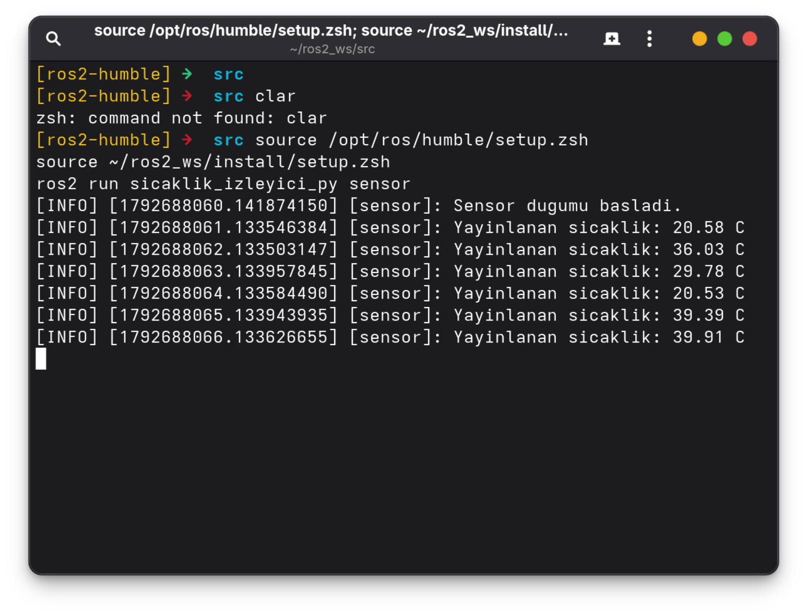
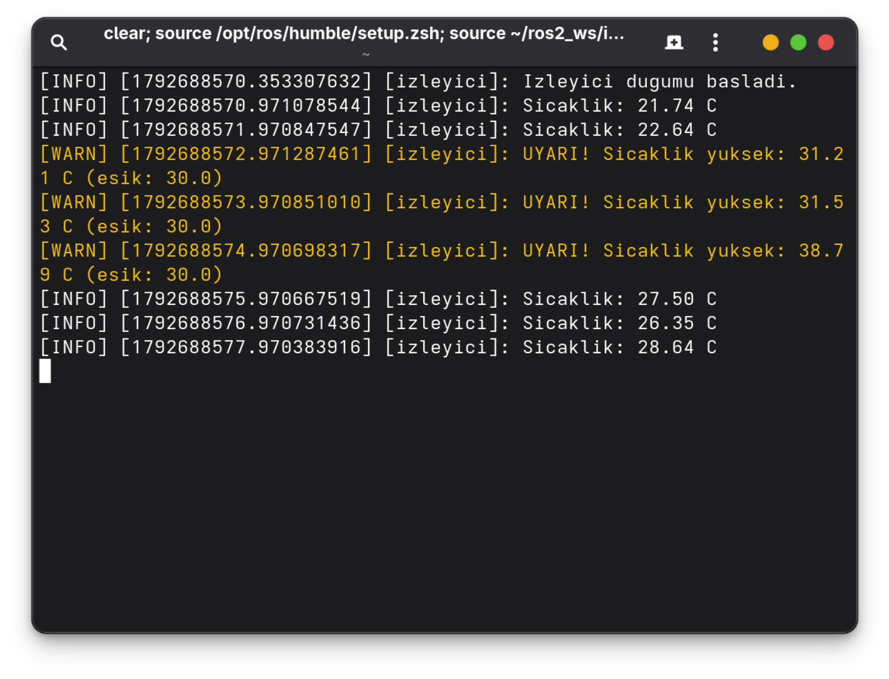
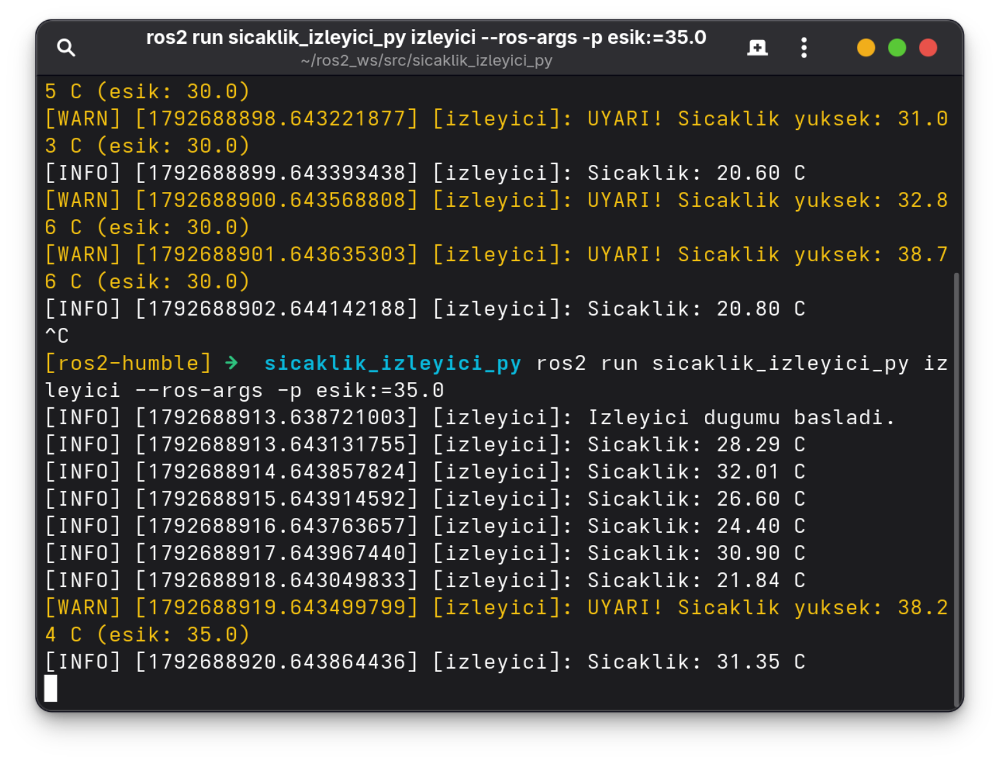
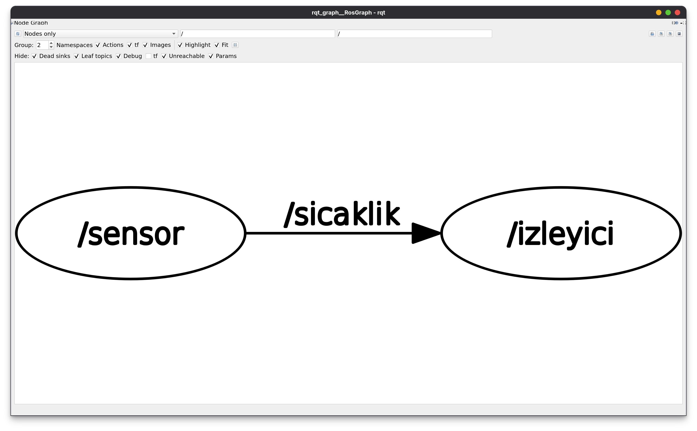

# Sıcaklık İzleyici (ROS 2 / Python)

> 📚 **Ödev Notu:** Bu proje, Robotiğe Giriş dersi kapsamında verilen **"Sıcaklık İzleyici"** ödevi için eğitim amaçlı hazırlanmıştır. Gerçek bir sensör kullanılmaz; sıcaklık değerleri rastgele üretilir.

İki düğümden oluşan bir ROS 2 Humble paketi:

- **sensor**: Her saniye 20–40 °C arası rastgele bir sıcaklığı `/sicaklik` konusuna `std_msgs/Float32` olarak yayınlar.
- **izleyici**: `/sicaklik` konusunu dinler ve değeri ekrana yazar. Değer eşiğin üzerindeyse `get_logger().warn()` ile uyarı verir.

**Bonus:** Eşik değeri `declare_parameter` ile tanımlanmış `esik` parametresidir (varsayılan: 30.0).

## İçindekiler

- [Gereksinimler](#gereksinimler)
- [Derleme](#derleme)
- [Çalıştırma](#çalıştırma)
- [Bonus: Eşik Parametresi](#bonus-eşik-parametresi)
- [Konuyu Dinleme](#konuyu-dinleme)
- [rqt_graph](#rqt_graph)
- [Paket Yapısı](#paket-yapısı)

## Gereksinimler

- ROS 2 Humble çalıştıran bir ortam
- ROS 2 Humble
- Python paketleri: `rclpy`, `std_msgs` (ROS 2 ile birlikte gelir)

## Derleme

**bash terminal**
```bash
mkdir -p ~/ros2_ws/src
cd ~/ros2_ws/src
git clone https://github.com/ramazanerentepe/sicaklik_izleyici_py.git
cd ~/ros2_ws
source /opt/ros/humble/setup.bash
colcon build --packages-select sicaklik_izleyici_py
```
---

**zsh terminal**
```zsh
mkdir -p ~/ros2_ws/src
cd ~/ros2_ws/src
git clone https://github.com/ramazanerentepe/sicaklik_izleyici_py.git
cd ~/ros2_ws
source /opt/ros/humble/setup.zsh
colcon build --packages-select sicaklik_izleyici_py
```

Bu komutlar bir çalışma alanı (`ros2_ws`) oluşturur, paketi `src` klasörüne indirir ve derler. `colcon build` mutlaka `src` içinde değil, **`ros2_ws` klasöründe** çalıştırılmalıdır; aksi halde `build`, `install` ve `log` klasörleri yanlış yerde oluşur. Derleme sonunda `Summary: 1 package finished` satırı görünüyorsa paket hatasız derlenmiştir.

## Çalıştırma

İki düğüm, iki ayrı terminalde çalıştırılır. Her yeni terminalde önce ROS 2 ortamı ve çalışma alanı yüklenmelidir (`source` satırları).

### Terminal 1: Sensör

**bash terminal**
```bash
source /opt/ros/humble/setup.bash
source ~/ros2_ws/install/setup.bash
ros2 run sicaklik_izleyici_py sensor
```
---

**zsh terminal**
```zsh
source /opt/ros/humble/setup.zsh
source ~/ros2_ws/install/setup.zsh
ros2 run sicaklik_izleyici_py sensor
```

Sensör düğümü her saniye yeni bir sıcaklık üretir ve `/sicaklik` konusuna yayınlar.



*Şekil 1: `sensor` düğümünün çıktısı. Düğüm başladıktan sonra her saniye 20–40 °C arasında rastgele bir değer yayınlanır (bu çalıştırmada 20.58, 36.03, 29.78, 20.53, 39.39 ve 39.91 °C). Satır başındaki sayı zaman damgasıdır; ardışık satırlar arasında 1 saniye fark vardır.*

### Terminal 2: İzleyici

**bash terminal**
```bash
source /opt/ros/humble/setup.bash
source ~/ros2_ws/install/setup.bash
ros2 run sicaklik_izleyici_py izleyici
```
---

**zsh terminal**
```zsh
source /opt/ros/humble/setup.zsh
source ~/ros2_ws/install/setup.zsh
ros2 run sicaklik_izleyici_py izleyici
```

İzleyici düğümü `/sicaklik` konusuna abone olur. Gelen değer eşiğin (varsayılan 30 °C) altındaysa `[INFO]`, üstündeyse sarı renkli `[WARN]` olarak yazdırılır.



*Şekil 2: `izleyici` düğümünün çıktısı. 30 °C'nin altındaki değerler (21.74, 22.64, 27.50 °C…) `[INFO]` olarak yazdırılırken, 30 °C'nin üzerindeki 31.21, 31.53 ve 38.79 °C değerleri sarı `[WARN] UYARI!` satırı olarak görünür.*

Düğümleri durdurmak için her iki terminalde **Ctrl+C** kullanılır.

## Bonus: Eşik Parametresi

Eşik değeri koda gömülü değildir; `declare_parameter` ile tanımlanmış `esik` parametresidir. Bu sayede kodu değiştirmeden ayarlanabilir.

**Başlatırken eşiği belirlemek için:**

**bash terminal**
```bash
ros2 run sicaklik_izleyici_py izleyici --ros-args -p esik:=35.0
```
---

**zsh terminal**
```zsh
ros2 run sicaklik_izleyici_py izleyici --ros-args -p esik:=35.0
```


*Şekil 3: Varsayılan eşik ile eşik 35 °C karşılaştırması. Üst kısımda varsayılan eşik (30 °C) ile çalışan izleyici 31.03 ve 32.86 °C için uyarı verir. Düğüm Ctrl+C ile durdurulup `esik:=35.0` ile yeniden başlatıldıktan sonra 32.01, 30.90 ve 31.35 °C gibi değerler artık `[INFO]` olarak geçer; yalnızca 35 °C'nin üzerindeki 38.24 °C `(esik: 35.0)` ile uyarı verir.*

**Düğüm çalışırken eşiği değiştirmek için** (üçüncü bir terminalde):

**bash terminal**
```bash
ros2 param get /izleyici esik
ros2 param set /izleyici esik 25.0
```
---

**zsh terminal**
```zsh
ros2 param get /izleyici esik
ros2 param set /izleyici esik 25.0
```

`param get` güncel eşik değerini gösterir, `param set` komutu ise `Set parameter successful` yanıtı verir. İzleyici her mesajda parametreyi yeniden okuduğu için yeni eşik, düğümü yeniden başlatmadan hemen devreye girer.

## Konuyu Dinleme

Sensörün yayınladığı ham mesajları doğrudan görmek için:

**bash terminal**
```bash
ros2 topic echo /sicaklik
```
---

**zsh terminal**
```zsh
ros2 topic echo /sicaklik
```

`Float32` mesajında tek bir alan (`data`) vardır. Düğüm çıktılarında 2 basamağa yuvarlanan değerlerin tam halleri burada görülür; her mesaj `---` ile ayrılır.

## rqt_graph

İki düğüm çalışırken yeni bir terminalde:

**bash terminal**
```bash
rqt_graph
```
---
**zsh terminal**
```zsh
rqt_graph
```



*Şekil 4: Çalışan düğümlerin grafiği. `/sensor` düğümü `/sicaklik` konusuna yayın yapar (publisher), `/izleyici` düğümü bu konuya abonedir (subscriber). Ok, verinin akış yönünü gösterir.*

## Paket Yapısı

```text
sicaklik_izleyici_py/
├── README.md                  # Bu dosya: kurulum ve çalıştırma
├── gorseller/                 # Ekran görüntüleri
│   ├── sensor.png
│   ├── izleyici.png
│   ├── esik_parametre.png
│   └── rqt_graph.png
├── package.xml                # Paket bilgisi ve bağımlılıklar (rclpy, std_msgs)
├── setup.py                   # Python kurulumu ve entry_points
├── setup.cfg
├── LICENSE
├── resource/
├── test/
└── sicaklik_izleyici_py/
    ├── __init__.py
    ├── sensor.py              # Yayıncı (publisher) düğüm
    └── izleyici.py            # Abone (subscriber) düğüm
```

---

*Bu depo ödev amaçlı hazırlanmıştır.*
